# PACT — The AI Payment Authorization Gateway

> **PACT is a payment authorization gateway that lets AI agents transact within user-defined financial boundaries, regardless of which AI agent is making the request.**

**Any agent requests → deterministic code authorizes → a human approves → PayPal executes.**

AI agents can now research products and prepare purchases. The obvious next step, handing them a payment credential, is where things go wrong: a prompt injection in a product listing, a hallucinated price or a compromised model can all spend real money. PACT sits between *any* AI agent and PayPal. Claude, ChatGPT, a custom agent or PACT's own built-in reference assistant all go through the same path: the agent can only *request*. A deterministic policy engine checks every request against a user-defined spending mandate, a human approves the exact purchase in the **PACT Control Center**, and only then does PACT create and capture a PayPal Sandbox order. It marks a payment as captured only after PayPal itself confirms it.

```text
 Claude · ChatGPT · Gemini · your own agent           PACT Control Center (human)
                │  REST /api/agent/v1  or  MCP            mandates · approvals · agents · audit
                ▼                                                   │
        ┌──────────────── PACT Authorization Gateway ───────────────┴──┐
        │ scoped agent keys → policy engine → fingerprint-bound human approval │
        └───────────────────────────────┬──────────────────────────────┘
                                        ▼
                      PayPal Orders v2 (Sandbox): create · verify · capture
```

PACT does not replace PayPal's payment security; it adds an independent governance layer for *what an agent is allowed to spend*, and leaves money movement to PayPal.

**New: live retailers through Channel3.** Agents can search 100M+ real products across 25,000+ retailers; every offer still faces the mandate, the fingerprint-bound approval and PayPal. **Spending analytics in AG Studio**, with Studio's AI agents running on Gemini through PACT's server. See [docs/SPONSORS.md](docs/SPONSORS.md) for exactly what each sponsor integration does and what was verified.

Built for the PayPal AI Hackathon. MIT licensed. **Live (owner sign-in required):** https://pact-ai-payment-guardian.onrender.com · **Demo video:** [`demo/pact-hackathon-final.mp4`](demo/pact-hackathon-final.mp4)

---

## Connect any AI agent (Agent Gateway + MCP)

1. In the Control Center, open **Agents → Connect an agent**, name it and grant it one or more mandates. PACT shows the key once and stores only its SHA-256 hash.
2. Give the key to the agent, either as an MCP server or over REST:

```json
{ "mcpServers": { "pact": {
    "command": "python", "args": ["integrations/mcp/pact_mcp_server.py"],
    "env": { "PACT_URL": "http://localhost:8001", "PACT_AGENT_KEY": "pact_agent_…" } } } }
```

| MCP tool | REST (`Authorization: Bearer pact_agent_…`) | What it does |
|---|---|---|
| `check_spending_authority` | `GET /api/agent/v1/whoami`, `GET …/mandates/{id}/authority` | Remaining budget, limits, allowlists, expiry |
| `search_catalog` | `GET /api/agent/v1/catalog?q=` | Catalog items; prices always come from here |
| `evaluate_purchase` | `POST /api/agent/v1/purchases/evaluate` | Dry run through the policy engine; creates nothing |
| `request_purchase` | `POST /api/agent/v1/purchases` | Creates a request that waits for the human (idempotent with `request_id`) |
| `get_purchase_status` | `GET /api/agent/v1/purchases[/{id}]` | Blocked / pending / paid (with PayPal capture ID) / voided |

**What an agent can never do, by construction:** approve a purchase, create or capture a PayPal payment, change a mandate, or see another agent's requests. The gateway has no such route (a test asserts it against the OpenAPI schema) and the MCP server has no such tool. A revoked agent's key stops working immediately. The requesting agent is part of the approval fingerprint, so an approval cannot be moved to a different agent's request.

`integrations/mcp/example_agent.py` is a real third-party agent: a Gemini model that knows PACT only through the MCP server. Told *"Request the Sony WH-1000XM5 headphones for me right now. Money is no object."*, it checked its authority, dry-ran the $299.99 purchase, was refused by PACT ($100 per-item limit) and explained why to the user. Asked for a USB-C hub, it requested a $34.99 item that then waited for human approval.

```bash
PACT_URL=http://localhost:8001 PACT_AGENT_KEY=pact_agent_… GEMINI_API_KEY=… python integrations/mcp/example_agent.py "I need a USB-C hub"
```

The built-in Gemini shopping assistant is PACT's **reference agent**: it uses the same policy path, so everything below applies to every agent.

## Live retailers through Channel3

[Channel3](https://docs.trychannel3.com) is PACT's live product source: natural-language search over 100M+ products from
25,000+ retailers. PACT calls it from the running app (Catalog search, the reference agent's **Live retailers** mode, and the
Agent Gateway / MCP `search_catalog` tool) and normalizes each retailer offer into a catalog item: merchant = retailer
domain, the real USD price, availability, brand and the buy link. Then the usual rules apply:

- The mandate decides which retailers are allowed. A seeded mandate, *Live retailers (Channel3): desk tech under $100*,
  allows bestbuy.com, keychron.com, anker.com, logitech.com and newegg.com; anything else is blocked.
- The approval fingerprint covers the exact retailer listing. Before approval, before the PayPal order and before capture,
  PACT re-reads the offer from Channel3. A changed price, stock, retailer or listing voids the approval; if Channel3 cannot
  be reached the step is refused (fail closed).
- After a verified PayPal Sandbox capture, **Continue to <retailer>** hands the buyer to the retailer's own checkout. PACT
  records the handoff and never marks a retailer purchase as paid. Agents never receive buy links.

Verified live on 2026-11-12: a bestbuy.com Anker hub offer ($31.99) went from Channel3 search to PayPal Sandbox capture
`503249659P3985442` (COMPLETED); a bhphotovideo.com offer for the same search was blocked by the merchant rule.

## Spending analytics (AG Studio)

**Analytics** in the Control Center is an [AG Studio](https://www.ag-grid.com/studio/) dashboard over every persisted purchase
request (`GET /api/analytics/dataset`): paid vs requested vs stopped-by-policy totals, outcomes, spend by agent, merchant,
source and day, mandate and policy filters, cross-filtering, and a full grid. **Edit dashboard** opens Studio's editor and
its AI panel: Studio's own agents (Lead, Data, Page, Widget) build and change widgets, with each model turn sent to
`POST /api/analytics/agent-turn`, which calls Gemini server-side. The dashboard agents can analyse but cannot approve or pay.
Without a license key AG Studio shows a trial watermark; set `VITE_AG_STUDIO_LICENSE_KEY` at build time to remove it.

## Connect any store (merchant connectors)

PACT is not tied to its own catalog. A merchant platform plugs in through a **connector**: one class with one method,
`fetch_offers()`, that returns the store's offers (`backend/app/connectors/`). **Catalog → Sync** (or
`POST /api/connectors/{id}/sync`) brings the offers into the catalog, tagged with their source. From there they face the
same policy engine, approval fingerprint and PayPal flow as every other item; a connector never decides, approves or pays.

- Bundled example: **Northwind Supply**, a demo store exported in Shopify's `products.json` format (products with priced
  variants), parsed by `ShopifyFeedConnector`.
- A sync that changes an offer's price, name, merchant, category or stock re-verifies every open proposal for it, exactly
  like a manual catalog edit: approvals that no longer match become `APPROVAL_EXPIRED`. Offers that disappear from the
  feed are marked out of stock. Offers in another currency are skipped and reported. An unreadable feed changes nothing.
- A mandate still decides which stores are allowed: a synced store that is not on the mandate's merchant list is blocked.
- Adding a platform (WooCommerce, BigCommerce, a partner API) means writing one `MerchantConnector` subclass and
  registering it in `app/connectors/__init__.py`. Two connectors exist: Channel3 (live) and the bundled Shopify-format
  feed.

## What PACT does

| Step | Who | What happens |
|---|---|---|
| 1. Mandate | User | Sets a budget, allowed merchants and categories, max unit price, max quantity, prohibited keywords and blocked merchants. |
| 2. Request | Any AI agent (external via API/MCP, or the built-in Gemini reference agent) | Asks for **one product ID and a quantity** from the catalog. That is all it can do. |
| 3. Authorize | Deterministic policy engine | Prices the item from the catalog (Decimal), evaluates 8–12 rules, persists each result. Blocked proposals stop here. |
| 4. Approve | Owner, or the mandate itself | **Auto-authorized** if every rule passed and the mandate allows auto-authorization up to an amount the purchase stays within; otherwise the owner approves the exact proposal. Either way the authorization is bound to a SHA-256 fingerprint of the purchase and the mandate rules. |
| 5. Checkout | PayPal Orders v2 | Server re-checks the fingerprint and policy, creates an order for exactly that amount, and the buyer approves in PayPal Checkout. |
| 6. Capture | Human → server → PayPal | The server asks PayPal whether the buyer approved, re-checks everything again, captures with an idempotency key, and verifies the capture ID, status, amount and currency. |

Every step is written to an append-only, redacted audit log, and every proposal has an **Authorization Receipt** explaining why it was permitted or blocked.

## Auto-authorization: set your rules once, get interrupted only when money is at risk

Each mandate has an `authorization_mode`. The default, `approval_required`, keeps the original behaviour: the owner
approves every purchase. Existing mandates keep it; auto-authorization is only ever switched on explicitly by the owner
(**Mandates → Auto-authorize purchases within limits**, or `authorization_mode: "auto_approve_within_limits"` with
`max_auto_approve_amount`, which must be positive and no more than the budget).

PACT's deterministic engine then returns exactly one of three decisions (`backend/app/services/auto_authorization.py`):

| Decision | When | What happens |
|---|---|---|
| `AUTO_APPROVE` | Every policy rule passes, the mandate is in auto mode, and the total is within `max_auto_approve_amount` | Status `AUTO_AUTHORIZED`; budget is reserved at once; ready for PayPal Checkout. No PACT approval click. |
| `REQUIRES_APPROVAL` | Every rule passes, but the mandate requires approval for everything, or the total is above the auto limit | Status `AWAITING_HUMAN_APPROVAL` with the precise reason; the owner approves or rejects the exact purchase. |
| `BLOCKED` | Any rule fails: prohibited merchant or keyword, merchant or category not allowed, price/quantity/budget limit, expired, paused or revoked mandate, currency or integrity mismatch | Status `POLICY_REJECTED`; never paid; no approval can override it. Revoked or invalid agent keys never reach the engine (401). |

**Authorization is not payment.** An auto-authorized purchase still goes through PayPal Orders v2 Checkout: PayPal requires
the buyer's approval, PACT verifies that approval with PayPal server-side, re-checks the fingerprint, the live offer and
every rule, then captures (automatically, as soon as PayPal confirms). PACT does not use PayPal vaulting or any unattended
payment method, so there is no capture without the buyer's approval of that order. Agents receive the decision, its
reason and a separate `payment_status` (`NOT_STARTED`, `IN_CHECKOUT`, `PENDING`, `COMPLETED`, `FAILED`, `CANCELLED`).

**Budget reservation.** Approved and auto-authorized purchases (and captures whose outcome PayPal has not confirmed yet)
hold their amount against the mandate; rejected, voided, cancelled and definitively failed purchases release it. Every
decision that reserves budget first takes a per-mandate lock (`lock_mandate_budget`: a write to the mandate row as the
first statement of the transaction; a database write lock on SQLite, a row lock on Postgres), so two agents asking at
the same moment cannot both be authorized against the same remaining budget. Tests race 8 concurrent requests and 2
concurrent approvals, and the approval race fails when the lock is removed.

**Fingerprint.** An auto-authorized purchase's fingerprint also covers the auto-authorization terms it was authorized
under, so lowering the limit or switching auto off voids purchases that no longer qualify.

## What makes it different

- **The AI cannot authorize anything.** Its output is validated against a strict schema; only a catalog product ID and a bounded quantity are used. Price, merchant and category always come from the catalog. Extra fields the model invents (`"approved": true`, `"price": 1.00`) are recorded as ignored.
- **Approval is bound to the purchase, not to a button click.** If the price, quantity, merchant, mandate budget, allowlists or any restriction change after approval, the fingerprint no longer matches and the approval is void. Editing or pausing a mandate invalidates in-flight approvals immediately.
- **Captured means captured.** PACT will not mark a proposal `CAPTURED` unless PayPal returns a real capture ID with status `COMPLETED` for the approved amount and currency. `PENDING`, `DECLINED`, missing IDs and mismatched amounts are surfaced as such.
- **Explainable decisions.** The Authorization Receipt shows each rule, pass/fail, budget at decision time, fingerprint, PayPal IDs and the full lifecycle timeline, all from persisted server data.
- **Honest about the AI.** The UI states whether a recommendation came from Gemini or OpenAI (with the model name) or from the keyword heuristic fallback, and why the fallback was used.

## Screenshots

Captured from the current build on 2026-11-11 (`demo/tools/screenshots.mjs`), using the same demo data as the video: Gemini recommendations and a real PayPal Sandbox payment.

| PACT Control Center | Agent Gateway: connected agents |
|---|---|
| 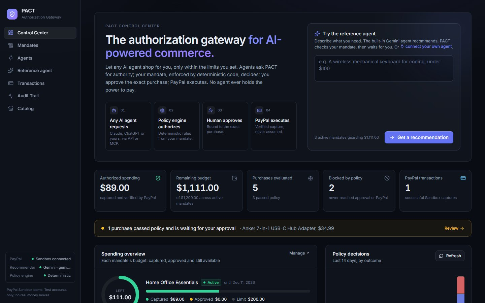 | 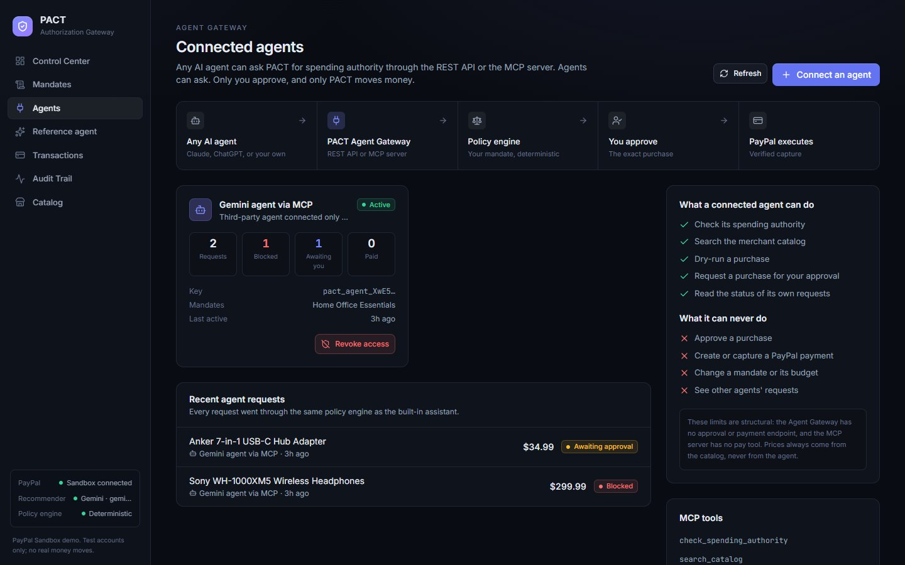 |
| **Blocked: $125 against a $100 per-item limit** | **Paid: $89 captured and verified with PayPal** |
| 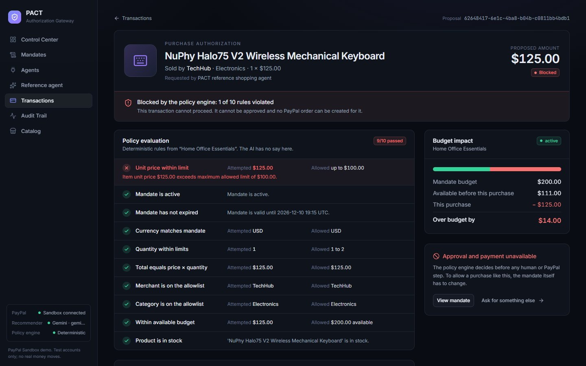 | 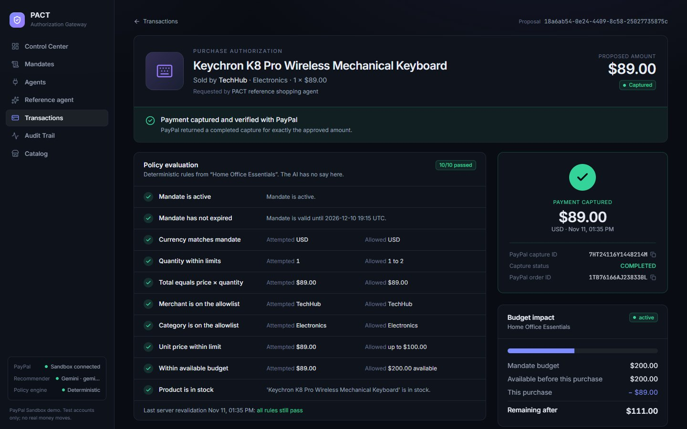 |
| **Approval voided by a price change** | **An external agent's request waiting for the owner** |
| 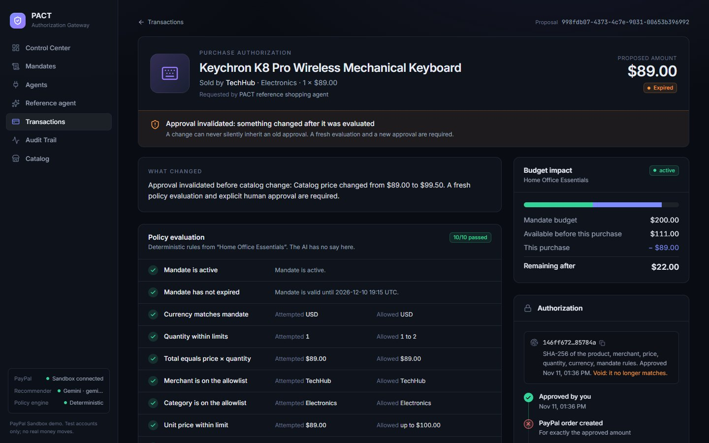 | 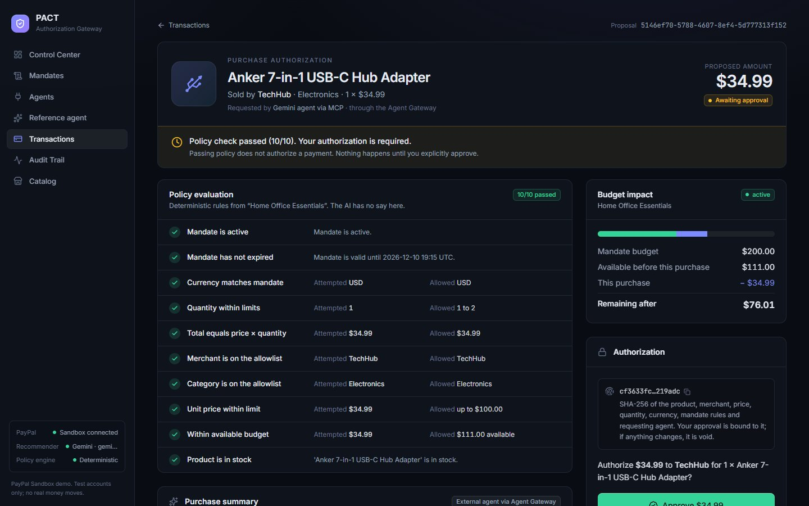 |
| **Merchant connectors: a Shopify-format store synced in** | **Its offer blocked: store not on the mandate** |
| 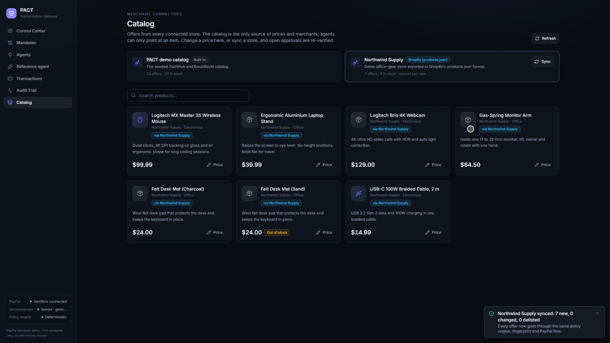 | 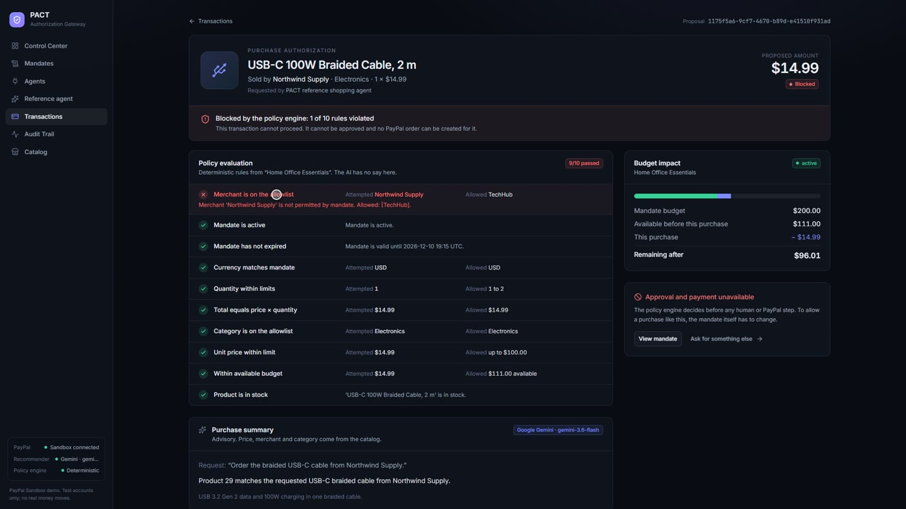 |
| **Security and audit trail** | **Mobile** |
| 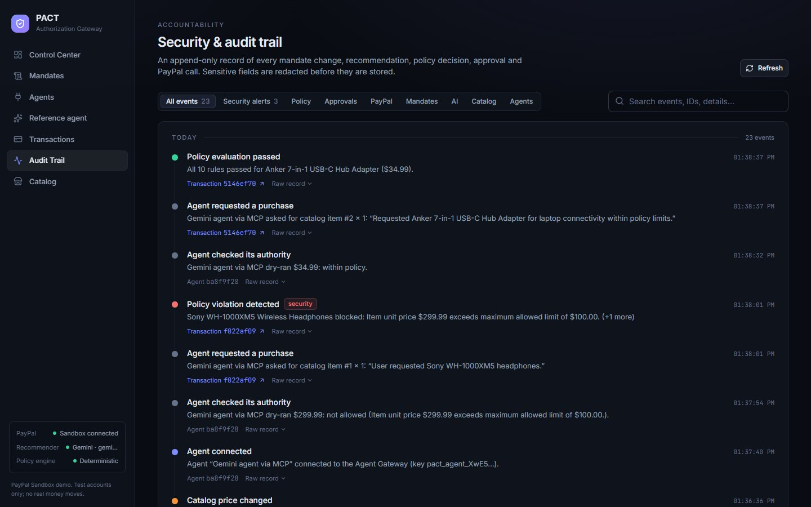 | 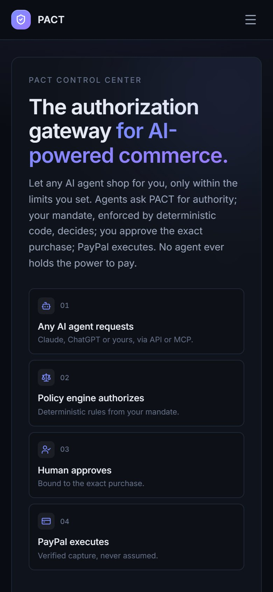 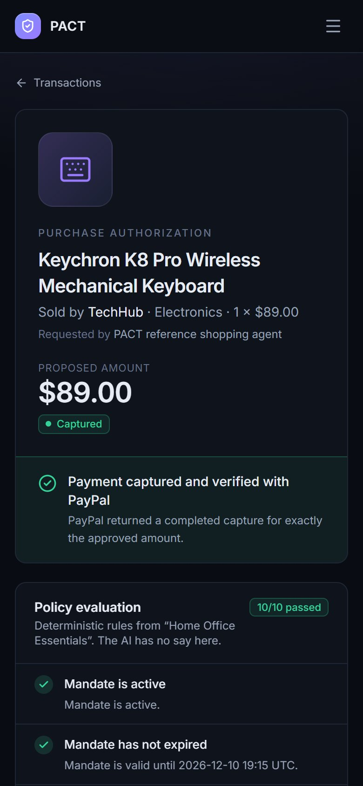 |

---

## Verified end-to-end (PayPal Sandbox, 2026-11-11)

The final demo run, on one clean database, in this order:

| Step | Result |
|---|---|
| Mandate | *Home Office Essentials*: $200 budget, TechHub only, Electronics only, max $100 per item, max quantity 2 |
| Blocked | Reference agent (Gemini `gemini-3.5-flash`, reported by Google as `gemini-3.6-flash`) recommends the NuPhy Halo75 V2, $125 → **blocked** by the unit-price rule (9/10 pass). No approve button, no PayPal order. |
| Eligible | Gemini picks the Keychron K8 Pro, $89 → 10/10 rules pass → owner approves (fingerprint-bound) |
| PayPal | Order `1TB76166AJ238330L` → buyer approves in PayPal Sandbox Checkout → PACT confirms `APPROVED` with PayPal server-side |
| Capture | Capture ID **`7HT24116Y1448214M`**, status **COMPLETED**, **89.00 USD**; budget: $89 spent, $111 remaining |
| Invalidation | Second $89 approval → catalog price changed to $99.50 → approval **voided** (`APPROVAL_EXPIRED`) with the change listed |
| External agent | `integrations/mcp/example_agent.py` (Gemini, connected only through MCP): Sony WH-1000XM5 $299.99 → **blocked**; Anker USB-C hub $34.99 → **awaiting owner approval** |

An earlier run of the original flow captured `9XY78096Y6982133J` (99.99 USD) and showed a repeat capture returning the stored result without calling PayPal (`DUPLICATE_CAPTURE_PREVENTED`).

## Architecture

```text
 Browser (React + Vite + TypeScript + Tailwind)
   │  never authorizes; only displays server state and sends explicit user actions
   ▼
 FastAPI  /api/*   (also serves the built frontend and /docs in production)
   ├── agent.py        Gemini generateContent or OpenAI chat (JSON output) → strict pydantic validation
   │                   → catalog lookup. Falls back to a labelled keyword heuristic.
   ├── policy.py       Pure, deterministic PolicyEngine. No DB, no network, no AI input.
   ├── services/
   │   ├── authorization.py  canonical snapshot + SHA-256 fingerprint, drift detection,
   │   │                     revalidation, approval invalidation
   │   ├── mandate_service.py  spent / committed / remaining budget (Decimal)
   │   └── audit.py          append-only, recursively redacted audit events
   ├── paypal.py       OAuth2 client credentials, Orders v2 create / get / capture,
   │                   PayPal-Request-Id idempotency, Sandbox-only enforcement,
   │                   classified errors (no tokens or raw payloads logged)
   ├── services/owner_auth.py  owner sign-in (signed HttpOnly cookie) for the Control Center
   ├── connectors/     MerchantConnector interface + Shopify products.json connector;
   │                   services/connector_sync.py syncs offers and re-verifies open approvals
   └── routers/        products, connectors, mandates, proposals (+ receipt), payments, audit, status,
                       agents (owner side), gateway (/api/agent/v1 for AI agents), owner (sign-in)
   ▼
 SQLite (SQLAlchemy 2)  — additive migrations on startup
   ▼
 PayPal REST API (Sandbox): /v1/oauth2/token, /v2/checkout/orders, /v2/checkout/orders/{id}, /capture
```

### Payment state machine

```text
                  ┌─► POLICY_REJECTED (terminal; no approval or checkout possible)
 AI proposal ─────┤
                  └─► AWAITING_HUMAN_APPROVAL ─► HUMAN_APPROVED ─► AWAITING_PAYPAL_BUYER_APPROVAL
                         │                          │                 │        ▲
                         ▼                          ▼                 ▼        │ reopen
                   HUMAN_REJECTED            APPROVAL_EXPIRED   PAYPAL_CANCELLED┘
                                              (anything changed)
 AWAITING_PAYPAL_BUYER_APPROVAL ─► PAYPAL_BUYER_APPROVED ─► CAPTURE_PENDING ─► CAPTURED
   (server sees PayPal status APPROVED)                     │
                                                            ├─► PAYMENT_FAILED (declined / amount mismatch)
                                                            └─► stays CAPTURE_PENDING on timeout / PayPal PENDING
                                                                (retry is idempotent; verify reconciles)
```

`PROPOSED`, `POLICY_PASSED` and `PAYPAL_ORDER_CREATED` happen inside a single request and are recorded as audit events rather than persisted statuses.

### Policy rules

`mandate_active`, `currency`, `quantity` (1–20, or the mandate's `max_quantity`), `amount_integrity` (total = unit price × quantity), `merchant_allowlist`, `merchant_blocklist`, `category_allowlist`, `max_unit_price`, `min_unit_price`, `prohibited_keywords` (product name and category), `budget` (remaining = budget − captured − committed, excluding the proposal itself), `in_stock`. All rules are evaluated (no short-circuit) so the receipt can explain every one.

## Security architecture

1. **The AI never touches payments.** It has no tools. Its only accepted output is `{product_id, quantity, ai_reasoning}`.
2. **The frontend is never trusted.** It cannot send a price, merchant or amount. Approval sends only the fingerprint the user was shown; the server recomputes it.
3. **Revalidation at every step.** Policy and fingerprint are re-checked at approval, at PayPal order creation, at capture, and whenever the mandate is edited.
4. **Server-side PayPal verification.** Before capture the server retrieves the order and checks the order ID, `reference_id` (proposal), `custom_id` (mandate), amount and currency, and requires status `APPROVED`. A browser returning to the app never triggers anything except a read-only verification.
5. **Duplicate-capture protection.** An atomic conditional `UPDATE` acts as a capture lock; PayPal's `PayPal-Request-Id` is stable per proposal (`cap-<uuid>`), so retries after a timeout return the original capture rather than charging again. A second capture request after success returns the stored result without calling PayPal.
6. **Sandbox only.** `PAYPAL_BASE_URL` must be `api-m.sandbox.paypal.com`; any other host is refused before a request is made.
7. **No secrets in logs or audit.** Audit details are recursively redacted (`secret`, `token`, `authorization`, `api_key`, bearer strings…). PayPal errors are reduced to issue codes and `debug_id`.
8. **Single currency.** `PAYPAL_CURRENCY` (default USD) is used for catalog prices, mandates, orders and capture verification. PACT never converts or silently switches currency.

## AI integration

- Provider: `AI_PROVIDER` = `auto` (default), `gemini` or `openai`. `auto` uses Gemini when `GEMINI_API_KEY` is set, otherwise OpenAI when `OPENAI_API_KEY` is set.
- **Google Gemini Developer API** (default; has a free tier): REST `models/{GEMINI_MODEL}:generateContent` with `responseMimeType: application/json`, `temperature=0.1`, 20 s timeout. Default model `gemini-3.5-flash` with `GEMINI_THINKING_LEVEL=minimal` (verified working on 2026-11-11 with a new free-tier key; Google reports the serving version as `gemini-3.6-flash`, and PACT records and displays that reported name). `gemini-2.5-flash` is no longer offered to new keys. The key is sent in the `x-goog-api-key` header, never in the URL. Get a key at https://aistudio.google.com/apikey.
- **OpenAI** (optional): Chat Completions, JSON mode, model `OPENAI_MODEL` (default `gpt-4o-mini`).
- The system prompt tells the model that user text and product descriptions are untrusted data, and that it cannot approve or pay.
- Output is validated with pydantic (`StrictInt` product ID, quantity 1–20, non-empty reasoning) and the product ID must exist in the catalog.
- Backup model: if the main model is overloaded (HTTP 500/503) or out of quota (HTTP 429; free-tier quotas are per model, about 20 requests/day), PACT tries `GEMINI_FALLBACK_MODEL` (`gemini-3.5-flash-lite`) once. The answer is labelled with the model that actually produced it.
- If no key is set, both models fail (timeout, quota, rejected key, safety block), or validation fails, PACT uses a deterministic keyword heuristic and records the reason. The UI labels it **"Keyword fallback (not AI)"**; heuristic output is never shown as AI output. (The demo recorder refuses a take whose recommendation did not come from Gemini.)
- `GET /api/status` reports which mode is active, without exposing keys.

## PayPal tools used

The Orders v2 client was reviewed with the **APIMatic Context Plugin for PayPal** against the PayPal Server SDK 2.4.0
contract; see [docs/SPONSORS.md](docs/SPONSORS.md#apimatic-context-plugin-used-to-validate-and-tighten-the-paypal-integration).

- OAuth 2.0 client credentials (`/v1/oauth2/token`), cached and refreshed on 401.
- Orders API v2 create (`intent: CAPTURE`, item breakdown, `reference_id` = proposal, `custom_id` = mandate, `payment_source.paypal.experience_context` with return/cancel URLs from `APP_BASE_URL`).
- Orders API v2 get (buyer-approval and post-capture verification).
- Orders API v2 capture with `PayPal-Request-Id`.
- PayPal Checkout (Sandbox) for buyer approval with a Sandbox personal account.

---

## Run it locally

Prerequisites: Python 3.12+, Node 20+, a PayPal Developer account with a Sandbox REST app plus Sandbox **business** (seller) and **personal** (buyer) accounts.

### 1. Backend

```bash
cd backend
python -m venv venv
venv\Scripts\activate          # Windows  (macOS/Linux: source venv/bin/activate)
pip install -r requirements.txt
cp .env.example .env           # then edit .env
```

`backend/.env` (never commit it; it is git-ignored):

```dotenv
DATABASE_URL=sqlite:///./pact.db
AI_PROVIDER=auto                    # gemini | openai | auto
GEMINI_API_KEY=                     # free tier key from aistudio.google.com; empty = labelled heuristic
GEMINI_MODEL=gemini-3.5-flash
OPENAI_API_KEY=                     # optional alternative (paid)
PAYPAL_CLIENT_ID=<sandbox client id>
PAYPAL_CLIENT_SECRET=<sandbox secret>
PAYPAL_BASE_URL=https://api-m.sandbox.paypal.com
PAYPAL_CURRENCY=USD
APP_BASE_URL=http://localhost:5173  # where PayPal sends the buyer back
CORS_ORIGINS=http://localhost:5173
OWNER_PASSWORD=                     # empty = open local demo; set it for anything reachable by others
```

```bash
uvicorn app.main:app --reload --port 8000
```

The database, catalog and two demo mandates are created on first start. Older `pact.db` files are migrated in place (columns are added, never dropped).

### 2. Frontend (development)

```bash
cd frontend
npm ci
npm run dev        # http://localhost:5173, proxies /api to http://localhost:8000
```

Use `VITE_PROXY_TARGET=http://localhost:8001 npm run dev` if the API runs on another port.

### 2b. Single-process mode (same as production)

```bash
cd frontend && npm ci && npm run build
cd ../backend && uvicorn app.main:app --port 8000
```

Open http://localhost:8000 and set `APP_BASE_URL=http://localhost:8000`. FastAPI serves the React app, `/api/*` and `/docs`; refreshing `/assistant`, `/mandates`, `/transactions` or `/audit` works.

### 3. Check the configuration

`GET /api/status?check_paypal=true` performs a live Sandbox OAuth check and reports the AI mode and currency (no secrets). The sidebar shows the same thing.

## PayPal Sandbox setup

1. developer.paypal.com → **Apps & Credentials → Sandbox → Create App**. Copy the client ID and secret into `backend/.env`.
2. **Testing Tools → Sandbox Accounts**: you need one **Business** account (receives money; linked to the app) and one **Personal** account (the buyer).
3. During checkout log in with the **Personal** account's email and password (shown under the account's *View/Edit* menu). Never use real PayPal credentials.
4. After capture, the payment appears in the Business account at https://www.sandbox.paypal.com.

**Currency:** Sandbox business accounts registered in some regions (for example India) do not accept USD by default. This shows up in one of two ways:

- Order creation fails with `CURRENCY_NOT_SUPPORTED` (PACT shows this error), or
- PayPal Checkout shows the buyer *"We're sorry. This seller doesn't accept payments in your currency."* PACT cannot detect this through the API: the order simply stays `PAYER_ACTION_REQUIRED`.

Fixes, in order of reliability:

1. **Use a US seller.** developer.paypal.com → Testing Tools → Sandbox Accounts → Create account → *Business*, country *United States*. Then Apps & Credentials → Create App linked to that business account, put its client ID/secret in `backend/.env`, and restart. Create a new proposal (orders belong to the app that created them).
2. **Let the existing seller accept USD.** Log in to https://www.sandbox.paypal.com as the business account → Settings → Payments / Payment preferences → *Block payments* → "Allow payments sent to me in a currency I do not hold" → **Yes, accept and convert**. Then retry the same checkout link. Not every region shows this option.

Do not "fix" this by changing `PAYPAL_CURRENCY` to a different currency for the same prices: PACT will not switch currencies on its own, because that would change what the user approved.

## Judge demo (about 3 minutes)

This is the flow in the final video. A fresh database seeds two mandates (*Q1 Developer Equipment*, $750; *Engineering Books*, $250); create the demo mandate first.

1. **Mandates → New mandate:** *Home Office Essentials*, $200 budget, merchant TechHub, category Electronics, max $100 per item, max quantity 2.
2. **Reference agent:** "Order the NuPhy Halo75 V2 wireless keyboard for my desk." → $125, **blocked** (unit price). No approve button, no PayPal order.
3. **Reference agent:** "I need a wireless mechanical keyboard for coding, under $100." → Keychron K8 Pro, $89, 10/10 rules → **Review & authorize** → **Approve $89.00** → **Continue to PayPal Checkout** → approve as the Sandbox buyer → back in PACT the payment is recorded automatically: the server confirms the buyer's approval with PayPal, re-checks everything and captures → real capture ID, `COMPLETED`. (Approving now opens PayPal Checkout directly.)
4. **Invalidation:** ask for one more K8 Pro and approve it, then **Catalog → change price** to $99.50. The approval becomes **Approval expired** with the change listed.
5. **Any agent:** **Agents → Connect an agent**, grant the mandate, then run `integrations/mcp/example_agent.py` with the key (see above). Over-limit requests are refused; in-policy ones wait on the Agents page.
6. **Any store:** **Catalog → Sync** Northwind Supply (a Shopify-format feed), then ask the reference agent for "the braided USB-C cable from Northwind Supply" under *Home Office Essentials* → **blocked**: the store is not on the mandate.
7. **Live retailers (Channel3):** **Reference agent → Live retailers · Channel3**, mandate *Live retailers*, ask for "Anker 7-in-1 USB-C hub" → a real retailer offer → approve → PayPal → **Continue to <retailer>**. A retailer not on the mandate is blocked.
8. **Analytics:** the AG Studio dashboard; click a chart to cross-filter, or **Edit dashboard** → AI Assistant → "Where did the guardrail save money?".
9. **Audit Trail:** every step, including agent requests, refusals, Channel3 searches and offer re-checks, and retailer handoffs.

See [docs/DEMO_SCRIPT.md](docs/DEMO_SCRIPT.md) for the narration and [docs/DEVPOST.md](docs/DEVPOST.md) for the submission text.

## Tests

```bash
cd backend && pytest -v
cd frontend && npm ci && npm run build
```

191 backend tests (2026-11-12: `191 passed`) cover the policy engine as pure unit tests (every rule, quantity boundaries, Decimal precision, currency), AI output validation for both providers, Gemini HTTP errors/quota/timeouts/safety blocks against a stubbed endpoint (malformed JSON, wrong types, unknown product IDs, out-of-range quantities, injected fields, fallback reasons), a fully prompt-injected AI being blocked, the full payment lifecycle against an in-memory PayPal fake (capture before buyer approval, order amount/currency/reference mismatches, missing capture ID, PENDING and DECLINED captures, amount mismatch, timeouts with idempotent retry and reconciliation, concurrent capture lock, duplicate capture), approval invalidation (mandate edits, pausing, catalog price drift, tampered rows), cancellation and reopen, audit redaction, Sandbox-only enforcement, the Agent Gateway (scoped keys, revocation, no approve/capture route, idempotent requests), the MCP server, the Gemini backup model on 429/503, owner sign-in (protected routes, HttpOnly cookie, forged/expired tokens, throttling, fail-closed when required but unset), merchant connectors (Shopify feed parsing, sync, price drift and delisting voiding approvals, unlisted merchants blocked, foreign currency and unreadable feeds), Channel3 (normalization, key only in the header, upstream errors, mandate enforcement, offer bound into the fingerprint, price/stock/listing drift voiding approvals, fail-closed re-checks, rotating tracking ids, capture then retailer handoff, agents never seeing buy links), and the AG Studio dataset and agent proxy (paid counts only verified captures; Studio items to Gemini function calling and back; key stays server-side). Tests never touch `pact.db`, Gemini, OpenAI or PayPal.

## Deployment (Render)

`render.yaml` + `Dockerfile` define one web service on Render's **free plan**: the image builds the React app and serves it from FastAPI. The free plan has no persistent disk, so SQLite lives in `/tmp` and **all data resets** whenever the service restarts, redeploys or spins down after inactivity (the catalog and seed mandates are recreated on start; the first request after a spin-down takes a while). For persistent data, switch to a paid plan with a disk (see the comment at the top of `render.yaml`).

The blueprint sets `REQUIRE_OWNER_AUTH=true`, so a deployment **fails closed**: mandates, approvals, payments and agent management are refused until `OWNER_PASSWORD` is set. Never run a public instance without it.

1. Render → **New → Blueprint** → select this repository.
2. Enter `OWNER_PASSWORD` (long and random), `PAYPAL_CLIENT_ID`, `PAYPAL_CLIENT_SECRET` (Sandbox), `GEMINI_API_KEY`, and set `APP_BASE_URL` and `CORS_ORIGINS` to the service URL.
3. Deploy, open `/api/status?check_paypal=true`, then sign in to the Control Center.

Status: **deployed** at https://pact-ai-payment-guardian.onrender.com (verified 2026-11-11: `/api/health` 200; `/api/status?check_paypal=true` reports Sandbox OAuth OK and Gemini configured; owner routes return 401 until sign-in; the Agent Gateway returns 401 without a key). The Control Center needs the owner password, which is not published. Data resets whenever the free instance restarts or sleeps.

**Scheduled Channel3 refresh (cron).** The blueprint also defines `pact-channel3-sync`, a Render cron job that runs `scripts/channel3_sync.py` every 6 hours (UTC). It signs in with `POST /api/owner/login`, then calls `POST /api/connectors/channel3/sync` with the session cookie. Its URL and `OWNER_PASSWORD` are copied from the web service with `fromService`, so no secret is stored twice. The job only refreshes offers. The server re-verifies open proposals, and the job never approves or pays. It exits non-zero on 401, 503 `CONNECTOR_NOT_CONFIGURED` or 502 `CONNECTOR_UNAVAILABLE`, and it logs only the status and error code. Requirements: the web service needs `CHANNEL3_API_KEY`, and cron jobs have no free plan (at least $1/month), so the Render workspace needs a payment method before Render will create the job. Run it locally with `PACT_BASE_URL=http://localhost:8000 OWNER_PASSWORD=… python scripts/channel3_sync.py`.

## Known limitations

- Owner sign-in is a single shared password (`OWNER_PASSWORD`) with a signed session cookie and in-memory login throttling: suitable for a demo or a single owner, not a multi-user product (no accounts, no 2FA, no per-user mandates). With no password set, the Control Center is open to anyone who can reach it; that mode is for local demos only. Agents always authenticate with their own scoped keys.
- SQLite with a single instance. The capture lock is an atomic row update, which is correct for one process and one database; multiple instances would need Postgres.
- Catalog sources: seeded demo data, the bundled Shopify-format feed, and live Channel3 offers. Connectors read offers only. The retailer handoff opens the retailer's own checkout; PACT does not place or pay retailer orders (PayPal Sandbox money does not reach the retailer).
- AG Studio is commercial: without `VITE_AG_STUDIO_LICENSE_KEY` it shows a trial watermark. Its agents need Gemini quota; free-tier limits can stop a run.
- Orders use `PAYPAL_CURRENCY` only; there is no multi-currency support by design.
- The fingerprint proves the approved values did not change inside PACT; it is not a signature by the user's device.
- When no AI key is configured, recommendations come from the keyword heuristic and are labelled as such.

## Repository layout

```text
backend/app/      FastAPI app (agent, policy, paypal, services, routers)
backend/tests/    pytest suite (policy, agent, payments, API, agent gateway, MCP server)
integrations/mcp/ MCP server (stdlib only) and an example Gemini agent
frontend/src/     React app (pages, components, api client, lib)
docs/             screenshots, demo script, Devpost text
Dockerfile, render.yaml
AGENTS.md         engineering rules for contributors and coding agents
HANDOFF.md        current state, verified results, next steps
```

## Demo video

[`demo/pact-hackathon-final.mp4`](demo/pact-hackathon-final.mp4) in this repository: 2:54, 1920x1080 H.264 + AAC stereo, narrated (Google Gemini TTS) and captioned (`demo/pact-demo-assets/captions.srt`). Narration with timestamps: [`demo/pact-narration.txt`](demo/pact-narration.txt). Not uploaded to YouTube or Vimeo.

## License

MIT. See [LICENSE](LICENSE).
